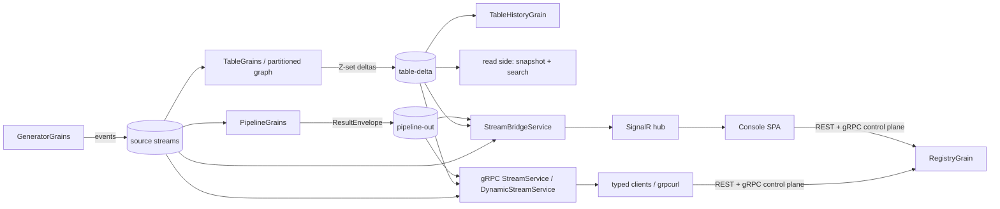

# StreamsForge — Architecture (Orleans implementation)

Streaming-SQL platform on Microsoft Orleans 10 / .NET 10. Users declaratively define **sources**
(synthetic generators), **pipelines** (windowed streaming SQL) and **materialized tables**
(incrementally-maintained views) via a console SPA, REST, or gRPC — gated by RBAC, observed live
over SignalR/gRPC streams, and consumable through generated typed client libraries.

This document describes *structure*. Rationale for the non-obvious choices lives in
[DESIGN.md](DESIGN.md); the historical execution plans (with acceptance criteria per phase) are in
[`../plans/`](../plans/README.md). User-facing docs: [`docs/index.html`](docs/index.html), served
at `/docs`.

## Project layout & the reuse boundary

Plan 005 (Dapr sibling runtime) extracted the runtime-agnostic core to repo-root `shared/` so both
flavors — `orleans/` (this document) and `dapr/` (`../dapr/ARCHITECTURE.md`) — build against the
identical Engine/Contracts/AppCore/Api assemblies. Paths below are current as of that extraction;
namespaces inside the moved files are frozen in place (decision D-C, plan 005) even where that
means an Orleans-flavored namespace (e.g. `StreamsForge.Host.Grpc.Dynamic`) lives in a shared
assembly — cosmetic, deliberate, and out of scope to rename.

| Project | Depends on | Role |
|---|---|---|
| `../shared/StreamsForge.Engine` | **nothing** (pure C#) | SQL compiler + executors + dataflow primitives. **Zero Orleans/Dapr dependencies by design.** *Shared with the Dapr flavor*: reused wholesale, byte-identical — the same `SqlCompiler`/`TableExecutor`/`PipelineExecutor` compile and run every pipeline and table on both runtimes. |
| `../shared/StreamsForge.Contracts` | `Microsoft.Orleans.Serialization.Abstractions` (attribute types only, decision D-A) | DTO/model contracts (`Models.cs`, `StreamConstants.cs`), runtime-neutral facade interfaces (`Facades.cs`: `ICatalogFacade`, `IUserStoreFacade`, `IPipelineReadFacade`, `ITableReadFacade`, `ITableHistoryFacade`, `IArrangementMetaFacade`), and the Dapr pub/sub envelope records (`Streaming/Envelopes.cs`). Evolution is **additive-only** (next free `[Id]`). *Shared with the Dapr flavor*: identical DTOs and facade contracts; the Dapr flavor's actor interfaces implement the same facades this repo's grain interfaces inherit. The Orleans `[GenerateSerializer]`/`[Id(n)]` attributes ride along as a benign dependency on the Dapr side (no Orleans runtime, no analyzers) rather than hand-maintaining ~22 parallel surrogate types. |
| `src/StreamsForge.Abstractions` | Orleans.Sdk + Contracts | Grain interfaces only (`GrainInterfaces.cs`) — each inherits the matching Contracts facade, so grain proxies double as facade implementations with zero test-visible change. `[assembly: Orleans.GenerateCodeForDeclaringAssembly(typeof(SourceDefinition))]` here generates serializers for the shared Contracts DTOs into this Orleans assembly. **Orleans-only** — the Dapr flavor has no equivalent project; its actor interfaces live directly in `dapr/src/StreamsForge.Dapr.Host/Actors/`. |
| `../shared/StreamsForge.AppCore` | Engine + Contracts (no Orleans/Dapr) | Orleans-free logic that used to live in this repo's `Host/`: dynamic protobuf machinery (`Protocol/` — descriptor factory, wire encoder, proto file builder), fuzzy/exact search (`Search/`), generator profiles (`Generators/MarketDataProfiles.cs`), row-history retention math (`History/`), `Auth/PasswordHasher`, `Json/JsonValueNormalizer`, and `SeedCatalog` (the demo world both flavors seed identically). *Shared with the Dapr flavor*: reused wholesale — every table/pipeline compiles via the same `Protocol`/`Search`/`History` code on both runtimes, and both seed from the same `SeedCatalog`. |
| `../shared/StreamsForge.Api` | Contracts + AppCore (no Orleans/Dapr) | REST endpoints (`Endpoints/*.cs`), the SignalR hub (`Hubs/StreamHub.cs`), JWT issuance (`Auth/JwtTokenService.cs`), and `AddStreamsForgeApi`/`MapStreamsForgeApi` (auth/policy/CORS/OpenAPI wiring, `/docs`, SPA static-file serving) — bodies reach the catalog/read-side only through the Contracts facades, never a concrete grain or actor type. *Shared with the Dapr flavor*: byte-identical endpoint code; this is what makes the frozen REST/SignalR contract enforced by construction rather than by convention (decision D-B). `/docs` is mapped only when `StreamsForgeApiOptions.DocsFilePath` is non-null — the Orleans host is the only one that sets it (see "Surfaces" below). |
| `src/StreamsForge.Host` | AppCore + Api + Abstractions + Orleans + ASP.NET | Co-hosted silo + web server (one process): grains (`Grains/`), the Orleans facade-proxy adapters, `Program.cs` wiring. **Orleans-only** — the Dapr counterpart is `dapr/src/StreamsForge.Dapr.Host` (actors instead of grains, Redis instead of JSON-file storage). |
| `tests/StreamsForge.Engine.Tests` | Engine (+ TestingHost for 2 smoke tests) | ~393 tests: compiler, executors, dataflow, determinism replays. Runs unmodified against `shared/StreamsForge.Engine` — this suite is the proof the Engine move was behavior-preserving. |
| `tests/StreamsForge.Host.Tests` | Host | ~118 tests: protobuf machinery, history retention, real `TestCluster` integration (seeds, partitioned tables, arrangements, frontiers). |
| `../web/` | — (bun, React 19, Vite, Tailwind v4, shadcn/ui) | Console SPA, moved to repo root in plan 005 W2 (was `orleans/web/`). Talks REST + SignalR only — no Orleans coupling. *Shared with the Dapr flavor*: the exact same built `web/dist` is served by both hosts (`StreamsForgeApiOptions.SpaDistPath`) — one build, two runtimes, verified via the frozen `types.ts` ⇔ `Dtos.cs` contract. |

## Engine: SQL → running operators

```
SQL text ──Tokenizer──▶ tokens ──Parser (recursive descent + Pratt exprs)──▶ AST
    ──Validator (scope stack, kinds, positioned diagnostics)──▶ ValidationResult
    ──Planner / TablePlanner (recursive: derived tables nest plans)──▶ CompiledPlan
    ──façade (PipelineExecutor / TableExecutor)──▶ operator chain
```

- **Two compilation modes**, one dialect. *Pipeline* mode: interval joins (`WITHIN`),
  TUMBLING/HOPPING/SESSION windows, `EMIT CHANGES|FINAL`, watermarks. *Table* mode: no windows;
  running aggregates, relational equi-joins over current state — INNER (default), LEFT/RIGHT/FULL
  OUTER (incremental null-padding, composite keys), and CROSS (`Parallelism = 1` only) — `LATEST BY`.
- **Grammar highlights**: `WITH`/CTEs + derived tables (recursion rejected), `[NOT] IN`/`EXISTS`
  (→ semi/anti joins), scalar subqueries (equality decorrelation), `UNNEST` over array fields,
  Postgres JSON `->`/`->>` with nested typed drill-down, qualified star `alias.*`.
- **Operators** (`Runtime/Ops/`, post-M1 decomposition): pipelines — Join/Window/FilterProject/
  Subquery(rolling-snapshot); tables — Ingest/Join/SemiAnti/Unnest/FilterProject/Reduce/LatestBy.
  Every table op exposes `OnBatch(Epoch, deltas)` / `OnFrontier(Epoch)` with an explicit,
  serializable state object. Executors are façades over these chains; a whole chain embeds as a
  node of another chain (that seam is how derived tables execute).
- **Z-set semantics** (tables): every change is a weighted delta; updates are retract(+old)/
  assert(+new) pairs; joins are bilinear; aggregates subtractable (multiset MIN/MAX). This is
  DBSP-style incremental view maintenance — correct under updates, not just appends.
- **Dataflow primitives** (`Dataflow/`): `Epoch`, `DeltaBatch`, `FrontierTracker` (min-combine,
  regression-detecting), `ExchangeRouter` (FNV-1a, process-stable), `EpochBuffer` (deterministic
  reorder/flush) — the protocol layer for partitioned execution, plus `TableDataflowPlan` (stage/
  edge graph with routing specs) and `ArrangementKeySpec`.

## Grain topology (Host)

| Grain | Key | Persisted | Role |
|---|---|---|---|
| `RegistryGrain` | `"catalog"` | yes | Source/pipeline/table catalogs + CRUD + start/stop orchestration; seeds on empty storage; resumes Running entities on boot (topo-sorted for table chains); owns the **field-number map** for dynamic protobuf; `[MayInterleave]` allowlist on read methods (see DESIGN — reentrancy). |
| `GeneratorGrain` | source name | no | Grain-timer synthetic event publisher (`trades`/`quotes`/`orders`/`json-events`/`multileg`/`lifecycle` profiles) → `("sources", name)` stream. |
| `PipelineGrain` | pipeline id | yes | Compiles SQL, subscribes source streams, runs a `PipelineExecutor` per event + 500 ms watermark timer, publishes `ResultEnvelope` batches → `("pipeline-out", id)`. |
| `TableGrain` | table name | yes | **Two modes.** Classic (`Parallelism == 1`): runs the whole `TableExecutor` in-grain, publishes deltas → `("table-delta", name)`, maintains consolidated snapshot (write-behind JSON) + search index. Coordinator (`Parallelism ≥ 2`): deploys/tears down the partitioned graph below and serves reads from deltas it consumes back. |
| `TableIngestGrain` | `{table}:{input}` | no | Subscribes a real input stream, stamps **epochs** (250 ms tick or 1000 events), routes batches into stage-0 partitions. |
| `TableStageGrain` | `{table}:{stage}:{partition}` | no | One partition of one operator stage: `FrontierTracker` + `EpochBuffer` + engine stage executor; processes on frontier advance; routes outputs downstream (hash-exchange on join/group keys, broadcast for scalar sides), all batched per `(edge, epoch)`. |
| `TableOutputGrain` | table name | no | Terminal gather: publishes to the table-delta stream **and** pushes `(partition, epoch)`-tagged batches to the coordinator for frontier-consistent reads. |
| `ArrangementGrain` | `{input}:{keySpecHash}:{partition}` | yes (checkpoint) | Shared indexed input state: refcounted attach/detach, snapshot-then-deltas handoff, checkpoint every ~10 s, GC at zero consumers. Two tables joining the same source on the same key share one arrangement set. |
| `TableHistoryGrain` | table name | yes | Opt-in row-version history fed by the table-delta stream (the stream *is* the event log): All/LastN/FirstN/MinBy/MaxBy retention + time window; row identity from GROUP BY/LATEST BY keys. |
| `UserStoreGrain` | `"users"` | yes | PBKDF2 credentials, seeded admin/editor/viewer. |

**Streams** (provider `"streams"`): namespaces `sources`, `pipeline-out`, `table-delta`,
`lifecycle`. `StreamBridgeService` (hosted service) relays them to SignalR groups. The transport
behind the provider name is switchable (`Streams:Transport`, post-005 latency work):

- **`pull`** (default) — stock Orleans memory streams. These are *pull-based*: pulling agents poll
  the in-memory queues every `GetQueueMsgsTimerPeriod` (default 100ms, tunable via
  `Streams:PullPeriodMs`), so every stream hop adds Uniform(0, period) latency and the
  generator→table→SignalR path pays it twice — measured p50 115ms / max ~200ms on `tableDelta`.
- **`push`** — an in-process push bus (`Host/Streaming/PushStream*`) registered as a drop-in
  `IStreamProvider` under the same name; no producer/consumer call-site differs between modes.
  Publish is a non-blocking bounded-channel write (`Streams:PushCapacity`, default 10k; overflow
  drops the incoming item and counts it); one pump task per subscription delivers into the grain's
  own turn via a grain extension (per-key FIFO, no call-cycle deadlocks by construction — publish
  never awaits inside the producer's turn); non-grain subscribers (`StreamBridgeService`, gRPC
  streaming) receive a `DeepCopier` copy on the pump. Measured p50 **1ms** / p99 6ms on the same
  benchmark — ahead of the Dapr flavor's Redis pub/sub (p50 7ms). Single-silo only by design
  (localhost clustering is this flavor's documented topology); a multi-silo deployment would swap
  back to a distributed stream provider.

See `docs/comparison.html` "Measured latency" for the full scoreboard and root-cause history.
**Persistence**: custom `JsonFileGrainStorage` — one JSON file per grain state under `data/`
(config `DataDir`); delete the directory to reseed.

## Partitioned table execution (opt-in, `Parallelism 2–16`)

```
source stream ─▶ TableIngestGrain ──epoch-stamped batches──▶ TableStageGrain grid ─▶ TableOutputGrain
                    (or shared ArrangementGrain for arrangeable join inputs)            │
                                                                                       ▼
   reads (rows/search/metrics) ◀── TableGrain coordinator ◀── frontier-tagged batches + delta stream
```

- Epochal DBSP model (unitemporal): frontiers advance per stage-partition; a batch is processed
  only when every upstream has passed its epoch; outputs flush deterministically.
- **Frontier-consistent reads**: the coordinator applies terminal batches atomically per epoch;
  `/rows` returns `frontierEpoch` — rows reflect *all* deltas ≤ F and none beyond, by construction.
- Late data: epoch-stamped at arrival, never dropped at the dataflow layer (business-time
  ordering is a query concern — e.g. `LATEST BY` compares row timestamps).
- Recovery: snapshots serve immediately; operator state rebuilds from live traffic
  (`Rebuilding` flag); arrangements additionally checkpoint.
- Measured (soak, 2 000 ev/s × 60 s): P=4 p99 latency **0.70×** the single-grain baseline
  (higher median from epoch batching, radically tighter tail — the point of the design).

## Stream replay (plan 026)

A producer-owned, sequence-numbered log sits behind the same attach gate plan 023's late-consumer
replay always used — `ReplayLog<T>` (`shared/StreamsForge.AppCore/Streaming/ReplayLog.cs`), an
in-memory ring (10,000 entries, unbounded by age unless the host's `Replay:RetainMs` says otherwise)
that assigns a monotonic `Seq`/`position` to every published row or batch, plus `Snapshot(ReplayFrom?)`
for "everything at/after this seq or timestamp" and `FirstSeq`/`LastSeq`/`TotalSeen` so eviction never
turns into a silent gap. `ReplayGate<T>` (Host, generalizing plan 023's private `SourceReplayGate`) is
the turn-based owner every producer grain shares: `ConnectorGrain`, `GeneratorGrain`,
`IngestSourceGrain` (D3 — ingest publishing had no grain of its own before this plan), `PipelineGrain`
(result batches) and `TableGrain` (delta batches, classic mode only — coordinator mode publishes from
`TableOutputGrain` and is not wired in yet). `BeginAttachAsync(ReplayFrom?)`/`EndAttachAsync()` is the
whole consumer protocol, unchanged in shape from plan 023: Begin → subscribe → feed the snapshot
through the handler → End in a `finally`.

**Persisted tier (D6, opt-in per definition via `replay: { persist, retainMs, maxBytes }`)**:
`ReplaySegmentLog` (`shared/StreamsForge.AppCore/Streaming/ReplaySegmentLog.cs`) backs the ring with
append-only NDJSON segments — `{seq, ts, appendedAtMs, payload}` per line — under
`DataDir/replay/<namespace>/<qualified key>/NNNNNN.ndjson`, rotated at `Replay:SegmentBytes` (default
8 MB) and pruned by age/bytes (whole segments only; a torn last line from a mid-write crash is dropped
on read, never fails the open). Write-behind on the owning grain's existing flush cadence — no new
persistence provider, deliberately (a `JournaledGrain` needs one this project does not register, and
`TableHistoryGrain`'s class doc already argued against reusing `TableJournalState`, which is per-key
coalesced, not a sequence). Persisting is what survives a grain reactivation: without it every ring
resets to `Seq 1` on the next activation, silo restart included.

`IReplayStatusFacade` (`shared/StreamsForge.Contracts/ReplayFrom.cs`) is the read side behind
`GET /api/{sources|pipelines|tables}/{key}/replay` — `GetSourceAsync`/`GetPipelineAsync`/
`GetTableAsync`, `null` for an unknown entity, `NotSupportedException` for a flavor with no log at all
(Dapr, until `dapr/PARITY.md` D11 closes). `ReplayFrom`/`ReplayConfig`/`ReplayStatus` are three small
records in `StreamsForge.Contracts`, additive on `SourceDefinition`/`PipelineDefinition`/
`TableDefinition` — a consumer definition's own `ReplayFrom` dictionary (`{"<input>": {seq|timestampMs}}`)
is applied once, at `StartAsync`, into the fresh executor a start always builds; never into a live one
(the Engine's `AllowedLatenessMs` watermark rule would turn every replayed row into a late event
otherwise), which is why editing it on a Running table/pipeline restarts it exactly like an SQL edit.
Full design (D1–D9), the wire shape (`from_seq`/`from_timestamp_ms`/`position`/`replay_truncated` on
`streamsforge.proto` and the `SubscribeSourceFrom`/`SubscribePipelineFrom`/`SubscribeTableFrom` hub
methods) and the operator-facing walkthrough: `orleans/docs/index.html` § Stream replay;
`plans/026-stream-replay.md` for the full decision table and per-wave outcomes.

## Environment isolation (plan 021)

An environment is not a field anywhere — it is **which key a singleton grain is activated at**.
`RegistryGrain`'s key is `EnvKeys.Qualify(env, "catalog")` (`EnvKeys.Qualify("", k) == k`, so the default
environment's key is the literal string `"catalog"`, byte-identical to every pre-plan-021 deployment), and
every name-keyed grain kind — `GeneratorGrain`, `ConnectorGrain`, `TableGrain` and its dataflow satellites,
`TableHistoryGrain`, the shard tier, `ArrangementGrain` — is activated the same way:
`EnvKeys.Qualify(env, name)`. `IPipelineGrain` stays keyed by its GUID id and needs no qualification at
all — a GUID is already unique across every environment. `IEnvironmentRegistryGrain` (key =
`StreamConstants.EnvironmentsKey`, `"environments"`) is the one singleton that is **never** itself
qualified — it is the thing that says which environments exist, so exactly one per silo is the point.

**A grain learns its own environment once, from its own primary key, never from the ambient.**
`RegistryGrain.OnActivateAsync` sets `_env = EnvKeys.EnvOf(this.GetPrimaryKeyString())` — `EnvKeys.EnvOf`
on a key with no `.` separator returns the empty string, so an activation whose key nobody ever qualified
learns `_env = ""` exactly as it always implicitly was. Every entity that grain's `Upsert`/`Create*Async`
methods write gets `Environment = _env` forced onto it, overriding whatever (if anything) the caller's
payload said — the same "server owns this field" discipline `CatalogRecordMerge.CarryServerOwnedFields`
already applies to `Revision`/`SchemaRevision`. Every call this grain makes to another grain kind passes
`_env` through `EnvKeys.Qualify`, never `EnvironmentAmbient.Current` — this is plan 021 D5 in one field:
the runtime reads the definition, not the ambient, because the ambient (an `AsyncLocal` written by exactly
one REST middleware) is empty outside a request and empty silently means default.

**Seeding is gated the same way.** `EnsureInitializedAsync` runs unconditionally on every environment's
`RegistryGrain` at boot, so already-`Running` sources/pipelines/tables resume everywhere — but its three
seed blocks (`SeedCatalog.Sources()`/`.Pipelines()`/`.Tables()`) only fire when `_env == EnvKeys.Default`.
Without that guard, creating an empty `staging` and restarting the silo would fill it with the demo
catalog on the next boot, silently.

**One lifecycle stream per environment**, not a new namespace: `RegistryGrain` publishes onto
`StreamId.Create(StreamConstants.LifecycleNamespace, EnvKeys.Qualify(_env, StreamConstants.LifecycleEventsKey))`
— the four namespace constants (`sources`, `pipeline-out`, `table-delta`, `lifecycle`) are unchanged; only
the entity key inside each stream id is qualified, which `StreamBridgeService` (below) and every table/
pipeline stream already did for free once `EnvKeys.Qualify` was applied at every `GetGrain<...>` call site.
Without a qualified lifecycle stream, a `staging` deploy would wake every `default` (and every other
environment's) lifecycle subscriber.

**SignalR groups are qualified at the relay, not at the grain.** `StreamBridgeService` composes group names
like `table:{EnvKeys.Qualify(env, name)}` when it relays a grain's stream onto SignalR; `StreamHub`'s
subscribe methods compose the identical qualified group name from the connection's own selected
environment (`ConnectionEnv`, read off `HttpContext.Items` — see `EnvironmentSelectionMiddleware`'s class
doc for why a hub connection can't read the ambient directly). The one exception is the `"metrics"` group,
left deliberately cluster-wide — see `StreamHub.SubscribeMetrics`'s own doc comment for the argument.

**`RegistryGrainKeys.RegistryFor`** (`orleans/src/StreamsForge.Host/Facades/RegistryGrainKeys.cs`) is the
one place `StreamsForge.Host` turns "which environment" into "which `IRegistryGrain`" — every
`GetGrain<IRegistryGrain>(StreamConstants.RegistryKey)` call site in this codebase became
`client.RegistryFor(env)` / `factory.RegistryFor(env)` instead, so there is exactly one place that
composes the qualified registry key. Which environment a caller passes is decided at the call site: a
facade answering one REST request passes `EnvironmentAmbient.Current`; a grain acting on its own
already-loaded definition passes that definition's `Environment` field; a background service that must
act on every environment (the four boot-time sweeps, `IngestDrainPumpService`) enumerates
`IEnvironmentRegistryGrain.ListAsync()` and loops.

## Surfaces (one process, two ports)

| Surface | Where | Notes |
|---|---|---|
| REST | `:5199 /api/*` | Full CRUD + validate + rows/search/history/metrics + proto downloads + `/api/meta/*`. JWT (HS256, 12 h), policies Viewer ⊂ Editor ⊂ Admin. OpenAPI at `/openapi/v1.json`, interactive reference at `/scalar`. |
| SignalR | `:5199 /hubs/stream` | Per-entity subscriptions (`pipeline:{id}`, `source:{name}`, `table:{name}`, `metrics`); token via `access_token` query. |
| SPA + docs | `:5199 /`, `/docs`, `/explorer` | Console (neutral StreamsForge branding, light default, `sf.theme`), interactive user docs, API Explorer (reflection surface UI). |
| gRPC | `:5299` (cleartext h2c) | Static control plane `streamsforge.v1` (CRUD/validate/Struct-row streaming) + hand-implemented **dynamic reflection**: every source/table/compiling-pipeline published as typed `streamsforge.dynamic.v1` messages; `DynamicStreamService.SubscribeEntity` streams typed `{Entity}Event`/`{Entity}Delta` bytes. Same JWT as metadata. |
| Typed clients | `GET /api/{kind}/{id-or-name}/proto` + `tools/generate-client.sh` | Self-contained proto3 per entity → scaffolded, built .NET client lib with typed `IAsyncEnumerable` subscribe. Field numbers persist in the registry (evolution-safe, never reused) so generated clients survive schema edits. |

## Request/data flow (one glance)



## Ingestion connectors (plan 006)

A source's `Kind` (`generator | url | file | folder | grpc`, default `generator`) selects a thin
driver, dispatched by `RegistryGrain` (`IsGeneratorKind` — `null`/empty/`"generator"` keeps the
pre-006 `IGeneratorGrain` path; every other kind goes to `IConnectorGrain`). All the real logic —
scheduling, backoff, mapping/format parsing, OpenAPI derivation, dedup/ledger tracking, gRPC
subscribing — lives in `shared/StreamsForge.AppCore/Connectors/**`, pure and runtime-free (no
Orleans types), unit-tested directly. `ConnectorPollCycle` (`Connectors/ConnectorPollCycle.cs`) is
the shared step function for the three polled kinds (`url`/`file`/`folder`):
`FormatParsers`/`RecordExtractor` (via `JsonPathLite` + `MappingSpec`) turn a fetched payload into
rows, `DedupTracker`/`FileLedger` (bounded 10 000 keys/entries, FIFO — plan 006 D-D) decide what's
new, `ScheduleCalc`/`BackoffPolicy` (Cronos cron or fixed interval, `min(30s·2^(k−1), 15 min)`
failure backoff) decide when the next cycle runs. `grpc` is not a poll — `GrpcSubscriberCore`
(`Connectors/Grpc/`) is a persistent reconnecting subscription against a remote's
`DynamicStreamService`, decoding frames with the new `ProtoWireDecoder` (the encoder's exact
counterpart, `AppCore/Protocol/ProtoWireDecoder.cs`).

Running `GeneratorGrain` and `ConnectorGrain` activations retain themselves with
`DelayDeactivation(Timeout.InfiniteTimeSpan)` until `StopAsync` restores normal collection.
Timer ticks, loopback queues and external session traffic cannot reactivate a collected driver;
the supervisor's 15-second pings are an additional safeguard, not the lifetime guarantee.
Ingest publishing is a grain call and can reactivate its producer normally.

`ConnectorGrain` (`orleans/src/StreamsForge.Host/Grains/ConnectorGrain.cs`, key = source name) is
the thin driver: `[PersistentState("connector", …)]` holds `SourceDefinition`, `Running`, the
dedup/ledger trackers' persistable snapshots, and every `ConnectorRuntimeStatus` field. url/file/
folder kinds run on a **one-shot grain timer** re-armed after every fire at the freshly computed
next-due time (cron correctness requires recomputing after each fire, not a fixed period); `grpc`
launches `GrpcSubscriberCore.RunAsync` as a background `Task` for the grain's lifetime. The
subscriber's `onRows`/`onStatus` callbacks run off the grain's turn (a background thread, not
grain-context), so they route back through a captured **self-reference** —
`this.AsReference<IConnectorGrain>()` for `EmitRowsAsync`, plus a grain-internal
`IConnectorStatusSink.ReportStatusAsync` for status transitions — a normal, safely-serialized grain
call from outside, never a direct touch of `state`. `OnActivateAsync` self-resumes (re-arms the
timer / restarts the subscriber) when persisted `Running` is true, mirroring
`RegistryGrain.EnsureInitializedAsync`'s boot-resume for generators/pipelines/tables. Emission goes
through the same door `GeneratorGrain` uses — one `EventRecord` per row onto
`(StreamConstants.SourcesNamespace, sourceName)` — so pipelines/tables/SignalR/SPA all work
unchanged for a connector-kind source.

**Config import/export** (`shared/StreamsForge.Api/Endpoints/ConfigEndpoints.cs` +
`ConfigImportService.cs`, `shared/StreamsForge.AppCore/Config/**`) is one implementation shared by
both flavors through `ICatalogFacade` only: `ConfigComposer` resolves `include` chains and merges
documents (later wins per `(kind, name)` entity, shallow field override — D-I), `ImportPlanner`
diffs a composed document against the live catalog into an apply-ordered plan (sources → tables
topo → pipelines; deletions last, reverse order), and `ConfigImportService.RunImportAsync` walks
that plan, recompiling every pipeline/table SQL through the real `SqlCompiler` against the
post-import world before writing anything. `SecretsMasker` masks URL header values and gRPC
password/token as `"***"` on every read/export and merges a written `"***"` back to the stored real
value on write — the same masking logic backs both `SourcesEndpoints` (per-entity CRUD) and
`ConfigEndpoints` (bulk export/import). See `orleans/docs/index.html`'s "Ingestion connectors" and
"Configuration import/export" sections for the user-facing contract (scheduling/backoff formula,
JSONPath-lite subset, OpenAPI type map, merge rules, import modes) — this section is structure only.

**Federation**: a `grpc`-kind source subscribing to `DynamicStreamService/SubscribeEntity` on
*another* StreamsForge instance (Orleans or Dapr) is how one instance's table/pipeline/source becomes
another's source. Being a federation *server* (accepting `SubscribeEntity` calls) stays Orleans-only
(`:5299`) — the Dapr flavor has no gRPC serving (plan 005 D-F stands); it can only be the
*subscriber* side. `GrpcSubscriberCore.ResolveMessageIdentAsync` resolves a `table:{id}`/
`pipeline:{id}` entity key's opaque id to the remote's display name (the actual basis for its
generated proto message name) via a REST GET against `GrpcSubConfig.RestAddress` before asking
v1alpha reflection for the symbol — a W6 fix (`ProtoTextSchemaParser`/`ReflectionSchemaWalker` both
key off names, never ids); `source:{name}` keys need no such lookup, since the ident already is the
name.

## Build / run / verify

```bash
~/.dotnet/dotnet test orleans/StreamsForge.sln          # 511 tests
cd web && bun run build                                # SPA (bun only, never npm)
~/.dotnet/dotnet run --project orleans/src/StreamsForge.Host   # :5199 + :5299
# config: --Http:Port --Grpc:Port --DataDir   ·  logins: admin/editor/viewer + "123!"
```
